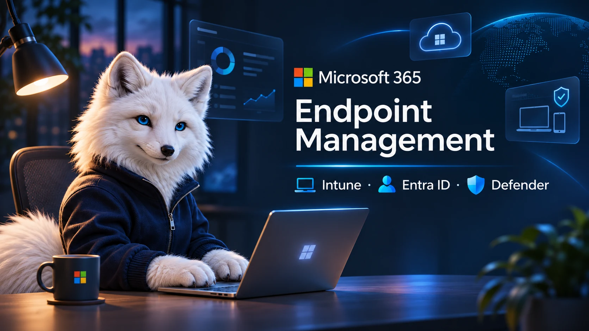
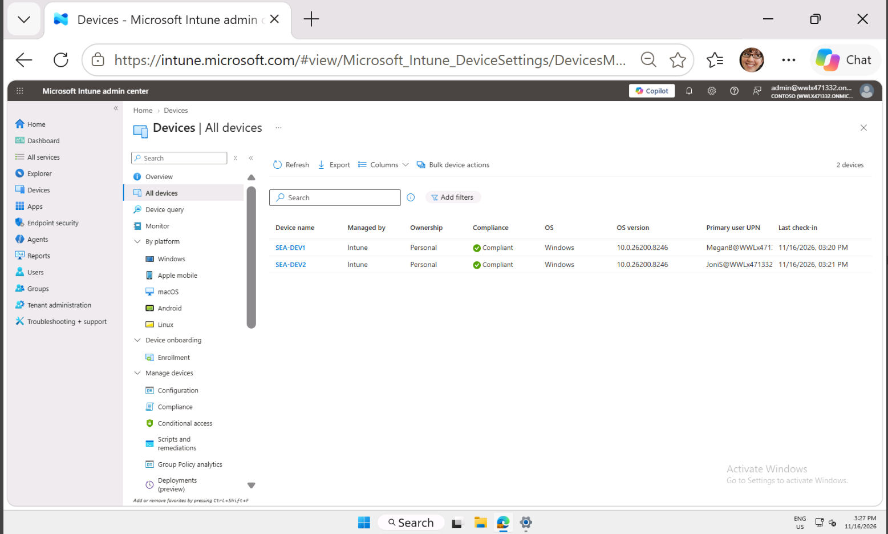

# Microsoft 365 Endpoint Management

**Microsoft Intune | Microsoft Entra ID | Microsoft Defender for Endpoint | PowerShell**  
Microsoft Software & Systems Academy (MSSA) — Server and Cloud Administration



## Project Overview

This project documents six hands-on labs involving cloud-based endpoint administration in a simulated **Contoso Healthcare** environment.

Using **Microsoft Intune, Microsoft Entra ID, Microsoft Defender for Endpoint, and PowerShell**, I configured device enrollment, Windows compliance policies, application deployment, endpoint security, automation, delegated administration, and remote support.

The labs progressed from identity and enrollment through advanced endpoint management. Each section distinguishes configuration work from observed device results. Some activities succeeded, while others exposed policy conflicts, incomplete deployments, or lab limitations. **This was a training environment, not a production rollout.**

### Business Scenario

Contoso Healthcare needs a consistent way to manage employees' Windows devices across departments. Administrators must enroll devices, distribute approved applications, enforce security requirements, and support users without configuring each workstation manually.

The company also needs to limit helpdesk privileges. Support personnel should be able to work with assigned devices without receiving unrestricted authority over every security policy or endpoint.

The six labs addressed these needs through identity and enrollment, device configuration, application management, security integration, automation and delegation, and controlled elevation and remote assistance.

## Lab Environment

| Component | Environment and purpose |
|---|---|
| Training tenant | Contoso Healthcare |
| Identity and device management | Microsoft Entra ID and Microsoft Intune |
| Endpoint security | Microsoft Defender for Endpoint |
| Windows endpoints | `SEA-DEV1`, `SEA-DEV2`, `SEA-DEV3` |
| Linux endpoint | `LIN-SRV1` (Ubuntu, used for Microsoft Tunnel preparation) |
| Administrative tools | Intune and Entra portals, PowerShell 7, Microsoft Graph SDK, SSH, Win32 Content Prep Tool |
| Licensing | Lab-provided Microsoft 365 licensing and an Intune Suite trial |

The lab used distinct groups and scopes to control assignments:

| Group or scope | Purpose |
|---|---|
| `sg-Intune-Pilot-Users` | Pilot user assignments |
| `dyn-Windows-Devices` | Dynamic Windows device targeting |
| `dyn-Autopilot-Devices` | Registered Autopilot devices |
| `Pharmacy` | Intune scope tag for delegated administration |
| `sg-Pharmacy-Helpdesk-Admins` | Membership for delegated helpdesk access |

---

## Lab 01 — Identity, Device Enrollment, and Autopilot

### Objective

Prepare the tenant to enroll Windows endpoints, target users and devices, and delegate selected administrative tasks.

### Identity and enrollment

I created pilot security groups and dynamic groups for Engineering users, Windows devices, and registered Autopilot devices. I also configured Entra administrative roles and an IT Department administrative unit. The Pharmacy scope tag and Pharmacy Helpdesk Intune role supported delegated administration later in the project.

Enrollment configuration included automatic MDM enrollment, a default Enrollment Status Page (ESP), a **pilot ESP with blocking behavior and a 60-minute threshold**, a ten-device enrollment limit, and a restriction on personally owned Android enrollment for the pilot scope.

I enabled Windows LAPS tenant settings and configured password backup to Entra ID, a 30-day password age, and 14-character passwords. **This was configuration work:** a later device report showed a LAPS error, so password rotation was not verified.

### Enrollment verification

I joined `SEA-DEV1` and `SEA-DEV2` to Microsoft Entra ID and checked their Intune records. Both appeared as Intune-managed Windows devices and reported **Compliant** at the initial checkpoint. Both records showed **Personal** ownership; later compliance requirements were assessed separately.



*Figure 1 — Intune records show both managed Windows endpoints as Compliant during initial enrollment verification.*

### Autopilot preparation

For `SEA-DEV3`, I imported hardware information and configured a user-driven Entra-join Autopilot profile through the dynamic device group.


*Figure 2 — SEA-DEV3 was registered for Autopilot, but profile assignment remained at Assigning.*

The exercise ended before the device reset and out-of-box provisioning process. **Autopilot registration and profile-assignment preparation were demonstrated; a completed Autopilot enrollment was not.**

**Operational value:** Centralized identity and device groups establish repeatable targeting, while enrollment restrictions and ESP settings provide controls over how devices join the managed environment.

---

## Lab 02 — Device Configuration, Compliance, and Troubleshooting

### Objective

Apply Windows settings from Intune, define security requirements, and use device reporting to investigate conflicting policies.

### Configuration and compliance

I created Settings Catalog power settings, device restrictions, and assignment filters. The power settings prevented unattended sleep while plugged in and used a **1,800-second** battery sleep threshold. I also imported a Group Policy XML report and migrated supported desktop settings into Intune.

On `SEA-DEV1`, **Config - Power Settings** and **Migrated - GPO Desktop Settings** later reported `Succeeded`. This demonstrated that supported traditional Group Policy settings could be managed through Intune in the lab.

The **Compliance - Windows Security Baseline** policy required BitLocker, Secure Boot, code integrity, storage encryption, Windows Firewall, antivirus, and password protections. Its minimum operating-system version was `10.0.19045`, with a seven-day grace period and a one-day user notification.


*Figure 3 — The Windows compliance policy defines encryption, Secure Boot, code-integrity, and other device security requirements.*

I also created **CA - Require compliant device (Pharmacy pilot)**. It remained in **Report-only** mode, so enforced access blocking was not tested.

### Windows updates and policy conflict

I configured pilot and standard update rings:

| Update ring | Quality update deferral | Feature update deferral |
|---|---:|---:|
| Pilot | 0 days | 0 days |
| Standard | 7 days | 14 days |

The lab also included a Windows 11 25H2 feature-update profile, an expedited quality-update policy, and Intune data collection. The data-collection policy reported `Succeeded`.

To investigate overlapping assignments, I deliberately applied conflicting camera policies. After reviewing device and per-setting status, I removed the **Enabled** pilot policy, synchronized the device, and confirmed **WIN - Camera - Disabled (Pilot)** reported `Succeeded`.


*Figure 4 — The camera Disabled policy succeeded after its conflicting counterpart was removed.*

The same report still showed two update rings in `Conflict` and **Contoso LAPS Policy** in `Error`. Those were not resolved by the camera-policy change.

**Operational value:** Device-level reporting helps distinguish a configured policy from a successfully applied setting. In this lab, the camera conflict was traced and resolved without claiming that other errors had disappeared.

---

## Lab 03 — Application Deployment and Data Protection

### Objective

Deliver applications through Intune, verify installation on endpoints, and configure controls for organizational data in mobile apps.

### Win32 packaging and deployment

I packaged **7-Zip 26.06 (x64)** using the Win32 Content Prep Tool and uploaded the `.intunewin` package to Intune. The app used System installation, an x64 requirement, MSI product-code detection, the Pharmacy scope tag, and a Required assignment to pilot users.

The first installation attempt used placeholder MSI filename and product-code values. After correcting the deployment commands, I checked per-device installation status.


*Figure 5 — The original 7-Zip application reported Installed on both Windows endpoints.*

This is a verified result for the original package, not proof of every subsequent deployment attempt.

### Other delivery methods

| Application | Configuration or observed result |
|---|---|
| Microsoft To Do | Configured through Microsoft Store integration |
| Microsoft 365 Apps | Assigned to the Windows device group |
| Google Chrome | Added from Enterprise App Catalog and made Available in Company Portal; last captured state was Installing |
| 7-Zip v2.0 | Simulated supersedence using the same binary; a replacement installation was not verified |

Available installation and Required installation serve different purposes. Company Portal makes an approved app available for self-service but is not by itself a universal software-installation block.

### Application protection

I created **APP - Android Data Protection** and **APP - iOS Data Protection**, targeting six Android apps and seven iOS/iPadOS apps respectively. The configurations restricted organizational data transfer and copy/paste, required encryption and a six-digit PIN, and applied conditions to the pilot user group.


*Figure 6 — Both mobile application protection policies appear as Deployed in Intune.*

The policy status supports successful configuration and deployment reporting. **Actual enforcement on mobile devices was not tested.**

**Operational value:** Win32 packaging and per-device reporting let administrators distribute and validate approved software. Application protection policies provide a separate layer of data control that is not equivalent to full device management.

---

## Lab 04 — Endpoint Security and Defender Integration

### Objective

Connect Intune-managed devices with security visibility, configure protection policies, and assess encryption and certificate-service readiness.

### Microsoft Defender integration

I configured the Intune–Defender connection and an EDR onboarding policy for `dyn-Windows-Devices`. Additional security work included a Defender baseline, antivirus and firewall profiles, and separate Attack Surface Reduction policies for **Block** (pilot) and **Audit** (fleet). Pharmacy scope tags extended the delegation approach to these security objects.

I verified that `SEA-DEV1` appeared in Microsoft Defender's device inventory.


*Figure 7 — SEA-DEV1 appeared with an Active health state and no active alerts or cases at the time of capture.*

Device visibility does not prove that every antivirus, firewall, or ASR setting has successfully applied. The fleet ASR exclusion targeted one endpoint and should not be interpreted as proof that every pilot user was excluded.

### BitLocker validation

I configured a disk-encryption policy, then checked the device locally with `manage-bde -status C:`.

| Field | Observed result |
|---|---|
| Conversion status | Fully Decrypted |
| Percentage encrypted | 0.0% |
| Protection status | Protection Off |
| Key protectors | None Found |


*Figure 8 — The local status check showed that BitLocker encryption had not completed.*

No recovery key was retrieved. The policy's existence is **not evidence of successful encryption or key escrow**.

### Microsoft Tunnel and Cloud PKI

I connected to the Ubuntu host `LIN-SRV1` through SSH, installed Microsoft Tunnel prerequisites, and registered the gateway. It later reported **Unhealthy**, and working VPN connectivity was not verified.

I also created a Cloud PKI root CA, which became Active. The issuing-CA setup could not proceed because its root selection remained unavailable. Trusted-certificate and SCEP profile deployment and client-certificate validation were not completed.

**Operational value:** Centralizing security administration is valuable only when administrators also inspect deployment, endpoint health, and encryption results. This lab provided both confirmed Defender visibility and clear evidence of unfinished protection tasks.

---

## Lab 05 — PowerShell Automation and Delegated Administration

### Objective

Use Microsoft Graph for repeatable administration, configure proactive remediation, and limit helpdesk privileges to the designated department and devices.

### Microsoft Graph authentication and queries

I registered **Intune Automation App**, granted application permissions for device inventory, configuration, group lookup, and RBAC reads, and connected through PowerShell 7 with the Microsoft Graph SDK.

After troubleshooting the PowerShell version and the difference between a client secret **Value** and its identifier, the successful session reported `AuthType: AppOnly`. I also retrieved the Pharmacy scope tag with ID `1`.

The inventory script selects policies by `RoleScopeTagIds`. This helps identify objects with the Pharmacy tag; it does **not** mean that application-only Microsoft Graph permissions inherit the same Intune scope restrictions as a delegated helpdesk account.

The published authentication script uses a secure prompt rather than a hardcoded client secret. This revised script was not rerun against the tenant during documentation. The later Graph-based compliance-policy creation and assignment tasks were skipped, and a complete policy inventory result was not verified.

### Pilot remediation

I configured **Remediation - Clear Stale Windows Update Cache** with separate detection and remediation scripts. The detection script looked for cache files older than 30 days and used exit code `1` to trigger remediation and `0` to indicate that no issue was detected.

The package was configured to run as SYSTEM with 64-bit PowerShell, with signature enforcement disabled and daily assignment to `sg-Intune-Pilot-Users`.


*Figure 9 — Detection and remediation scripts were configured with a daily pilot-group assignment.*

Execution results remained unavailable during verification. **The package was created and assigned, but successful cache cleanup was not confirmed.** The reference script also suppresses some errors, so its success message should not be treated as sufficient proof of cleanup.

### Helpdesk delegation

I created a **Pharmacy Helpdesk** role assignment using `sg-Pharmacy-Helpdesk-Admins`, `dyn-Windows-Devices`, and the Pharmacy scope tag. Lee Gu was a member of the helpdesk admin group.

The configuration separated administrative permissions, target users/devices, and the tagged policy objects administrators could see. The assigned role was intended to allow selected support actions without policy authoring or wipe/delete privileges.


*Figure 10 — The Pharmacy-tagged antivirus policy was accessible without editing controls during the delegated-admin test.*

The cropped image does not independently identify the signed-in account, so the evidence should not be generalized into verification of every helpdesk permission.

**Operational value:** Graph-based queries can make administrative checks repeatable, while Intune roles and scope tags help avoid giving a departmental helpdesk unrestricted tenant-wide permissions.

---

## Lab 06 — Endpoint Privilege Management and Remote Help

### Objective

Configure controlled application elevation and provide remote support with recorded session history.

### Endpoint Privilege Management

I created **EPM Settings - Default Behavior**, a Windows elevation settings policy assigned to the dynamic Windows device group. The settings required user confirmation and a business justification for the default elevation response, and enabled elevation reporting.

The policy reported **two successful device check-ins, zero errors, and zero conflicts**.


*Figure 11 — EPM settings reported two Succeeded check-ins and no errors or conflicts.*

I also worked through file-hash elevation rules for:

- `regedit.exe` — automatic elevation
- `msconfig.exe` — user-confirmed elevation
- `cmd.exe` — support-approved elevation

SHA-256 file hashes identified the executable targets. The rules targeted pilot users; the overall EPM settings policy targeted the Windows device group.

Elevation tests were attempted, but opening an elevated command prompt did not prove that the support-approval workflow had completed. **EPM settings delivery was verified; each elevation-rule path was not.**

### Remote Help

I enabled Remote Help, restricted support to enrolled devices, verified participants' lab licensing, and packaged the Remote Help installer as a Required Win32 app for `dyn-Windows-Devices`.

During testing, **Megan Bowen** provided remote assistance to **Joni Sherman** on `SEA-DEV2`. I reviewed Intune's Remote Help session report afterward.


*Figure 12 — The report records Megan as provider, Joni as recipient, and SEA-DEV2 as the supported device, with session start and end fields.*

This is evidence of a recorded support session, not just an application assignment. The session is not attributed to Lee Gu, whose scoped device access was checked separately.

Advanced Analytics and Device Query were part of the extended lab scope, but no populated query result is claimed. Windows 365 and Azure Virtual Desktop were discussed or demonstrated, not deployed as Cloud PCs or session hosts.

**Operational value:** EPM supports controlled application elevation without permanently making standard users local administrators. Remote Help offers a managed support process with session records for administrative review.

---

## PowerShell Scripts

Four PowerShell scripts accompany the administrative exercises. They preserve the documented lab logic while separating authentication, inventory, detection, and remediation.

| Script | Purpose | Verification boundary |
|---|---|---|
| [Connect-GraphApp.ps1](scripts/Connect-GraphApp.ps1) | Connect to Microsoft Graph with app credentials | Publication-safe credential prompt; revised copy not rerun |
| [Get-PharmacyPolicies.ps1](scripts/Get-PharmacyPolicies.ps1) | Query configuration and compliance policies tagged Pharmacy | Connection and tag lookup verified; full inventory not |
| [Detect-StaleWindowsUpdateCache.ps1](scripts/Detect-StaleWindowsUpdateCache.ps1) | Detect Windows Update cache files older than 30 days | Uploaded; successful device execution unverified |
| [Remediate-StaleWindowsUpdateCache.ps1](scripts/Remediate-StaleWindowsUpdateCache.ps1) | Remove matching aged cache files | Uploaded; successful cleanup unverified |

**Safety and usage:** These are training implementations, not production-ready remediation tools. The detection and remediation scripts can hide enumeration or file-operation failures through `-ErrorAction SilentlyContinue`. Test them on controlled systems before adapting them for operational use. Do not commit client secrets, credentials, tokens, recovery keys, or private keys.

## Results and Verification Summary

| Area | Verified result | Limitation or unresolved work |
|---|---|---|
| Identity and enrollment | Two Windows endpoints enrolled and initially Compliant | Autopilot provisioning not completed; LAPS later reported Error |
| Device configuration | Power and migrated GPO settings succeeded; camera conflict resolved | Update rings still conflicted; Conditional Access was Report-only |
| Applications | 7-Zip installed on both Windows endpoints; mobile app protection policies deployed | Mobile enforcement, Chrome completion, and supersedence replacement not verified |
| Endpoint security | SEA-DEV1 visible and Active in Defender | BitLocker not encrypted; Tunnel unhealthy; issuing CA blocked |
| Automation | AppOnly Graph connection and Pharmacy scope-tag lookup succeeded | Full inventory and remediation execution not verified |
| Privilege management | EPM settings succeeded on two devices | Individual elevation-rule outcomes not fully verified |
| Remote support | Help session on SEA-DEV2 appeared in session reporting | No wider support rollout demonstrated |

## Operational Impact

This project connects several endpoint management responsibilities within one cloud administration environment:

- **Device management:** Entra ID enrollment, dynamic groups, and Intune assignments establish consistent targets for endpoint configuration.
- **Security visibility:** Compliance policies, Defender integration, and device reports let administrators inspect where a control is configured, applied, conflicting, or unsuccessful.
- **Application delivery:** Centralized packaging and assignments reduce the need for individual workstation installs, while device reports provide confirmation for the applications tested.
- **Access control:** Intune RBAC, scope tags, and EPM settings demonstrate different ways to limit administrative authority and elevation.
- **Support and troubleshooting:** Configuration reports, remediation packages, and Remote Help offer tools for identifying endpoint issues and assisting users.

The recurring requirement is to **verify behavior rather than assume that creating a policy means it works**. In the lab, some configurations succeeded while others remained incomplete or showed errors. Those boundaries are retained because they matter in real systems administration.

The project demonstrates practical work in a simulated environment. It does not establish production-wide enforcement, measured time savings, or a rollout at an actual healthcare organization.

## Repository Structure

```text
Microsoft-365-Endpoint-Management/
├── README.md
├── assets/
│   └── m365-endpoint-management-fox-banner.webp
├── screenshots/
│   ├── 01-enrolled-devices.png
│   ├── 02-autopilot-assignment.png
│   ├── ... (12 selected lab screenshots)
│   └── 12-remote-help-session.png
└── scripts/
    ├── Connect-GraphApp.ps1
    ├── Get-PharmacyPolicies.ps1
    ├── Detect-StaleWindowsUpdateCache.ps1
    └── Remediate-StaleWindowsUpdateCache.ps1
```

Twelve screenshots were selected—two from each lab—to show meaningful configurations, troubleshooting, and observed results without reproducing every portal step.

**Technologies:** Microsoft Intune · Microsoft Entra ID · Microsoft Defender for Endpoint · Windows Autopilot · Windows LAPS · Conditional Access · Microsoft Graph PowerShell · PowerShell 7 · Win32 Application Deployment · Mobile Application Protection · Proactive Remediations · Intune RBAC · Endpoint Privilege Management · Remote Help