# Microsoft 365 Endpoint Management

**Intune · Entra ID · Defender for Endpoint · PowerShell · Security & Automation**  
Microsoft Software & Systems Academy (MSSA) | Server and Cloud Administration | November 2026


## Project overview

I configured and tested a Microsoft 365 endpoint-management environment across six connected MD-102 labs in a simulated **Contoso Healthcare** tenant. The work began with user identities, management groups and Windows enrollment, then progressed into device configuration, compliance, software delivery, Defender integration, PowerShell automation, delegated administration, Endpoint Privilege Management (EPM), and Remote Help.

The scenario was an IT team supporting devices across departments while maintaining different levels of administrative access. The goal was not simply to create policies in a portal. I needed to see which devices were actually enrolled, whether applications installed, whether settings reached their targets, and how to investigate a configuration when the expected result did not appear.

The labs were conducted on hosted Windows and Linux virtual machines. **This was a training environment, not a production healthcare deployment.** Some tasks were confirmed on endpoints; others remained in progress or were blocked by the lab environment. Those differences are recorded throughout the project.

### Selected results

| Area | What the lab evidence supports |
|---|---|
| Enrollment | `SEA-DEV1` and `SEA-DEV2` appeared as Intune-managed Windows devices and initially reported Compliant |
| Device configuration | Two supported GPO settings migrated into Intune; a deliberate camera-policy conflict was resolved and verified |
| Applications | A failing 7-Zip Win32 deployment was corrected; both test devices subsequently reported Installed |
| Defender | Managed endpoint `SEA-DEV1` appeared in Microsoft Defender with an Active health state |
| Automation and delegation | Microsoft Graph app-only authentication succeeded; Pharmacy-tagged policy read access was tested without edit controls |
| EPM and support | The EPM settings policy reported two successful check-ins; a Remote Help session was recorded for `SEA-DEV2` |

## Environment and management approach

| Component | Role |
|---|---|
| Microsoft Entra ID | User identities, security groups, dynamic group rules, directory roles, administrative units, and Conditional Access |
| Microsoft Intune | Windows enrollment, device settings, compliance, application distribution, endpoint security, remediation, EPM, and Remote Help |
| Microsoft Defender for Endpoint | EDR onboarding, endpoint inventory, health state, and security posture |
| `SEA-DEV1`, `SEA-DEV2` | Windows 11 endpoints used for enrollment, configuration, application deployment, and support testing |
| `SEA-DEV3` | Autopilot registration and later EPM/elevation testing |
| `LIN-SRV1` | Ubuntu server used for Microsoft Tunnel gateway preparation |
| PowerShell 7, Microsoft Graph, SSH | Command-line administration, inventory, automation, and Linux service preparation |

The same targeting design connected the labs. The assigned group **`sg-Intune-Pilot-Users`** selected a controlled group of five test users. **`dyn-Windows-Devices`** identified Windows device objects for broader assignments. **`dyn-Autopilot-Devices`** targeted registered Autopilot hardware. The **Pharmacy** Intune scope tag marked selected policies and devices for delegated administration.

These objects have different purposes. A **group assignment** determines who or what receives a policy. An **assignment filter** refines that target. An **Intune scope tag** affects what delegated administrators can see and manage; it does not deploy the policy. Keeping these distinctions clear was important when configuring and troubleshooting the environment.

---

## Lab 01 — Identity, enrollment, and Windows Autopilot

### Preparing identities and assignment targets

The first requirement was to establish consistent targets before deploying any device configurations. I reviewed existing cloud users and licensing, created two unlicensed test identities, and assembled the five-user pilot security group. I also configured dynamic groups so eligibility could follow user attributes and device registrations instead of maintaining every membership manually.

| Group | Rule or targeting purpose |
|---|---|
| `sg-Intune-Pilot-Users` | Assigned pilot group for applications, ESP, updates, ASR, remediation, and EPM rules |
| `dyn-Engineering-US-Users` | Users in Engineering **and** with US usage location |
| `dyn-Windows-Devices` | Devices whose OS type is Windows |
| `dyn-Autopilot-Devices` | Devices with the Autopilot registration identifier |

```text
(user.department -eq "Engineering") -and (user.usageLocation -eq "US")
(device.deviceOSType -eq "Windows")
(device.devicePhysicalIDs -any (_ -startsWith "[ZTDid]"))
```

The Engineering group initially showed **Not started** during membership evaluation. That was not sufficient evidence of completed membership processing, so I treated the rule as configured rather than verified for every user.

I assigned selected Entra administrative roles, created an **IT Department** administrative unit, and configured a Helpdesk Administrator assignment scoped to that unit. In parallel, I created the **Pharmacy** scope tag and custom **Pharmacy Helpdesk** Intune role for the later device-management test. These are different delegation systems: Entra administrative units scope supported directory administration, whereas Intune RBAC governs endpoint-management operations and visibility.

The custom role allowed policy reading and selected managed-device actions, such as synchronization and assistance, while excluding policy authoring, assignment changes, and device wipe/delete rights. Its behavior was tested later in Lab 05.

### Enrollment configuration and LAPS

I configured device-join and automatic Intune MDM enrollment settings. The default **Enrollment Status Page (ESP)** displayed setup progress, while **ESP - Pilot - Blocking** prevented the targeted user from proceeding until required applications and profiles finished or the configured **60-minute** threshold was reached. Pilot enrollment was limited to **10 devices per user**. For Android, the pilot restriction permitted corporate Android Enterprise enrollment while blocking personally owned enrollment and the older device-administrator method.

I also enabled Windows LAPS in the tenant and created **Contoso LAPS Policy** with password backup to Entra ID, a **30-day** password age, **14-character** passwords, and a **24-hour** post-authentication reset delay. The later device report displayed **Error** for this policy. Its creation was demonstrated; successful backup and rotation were not.

### Enrolling and verifying the Windows endpoints

I used Windows **Access work or school** on `SEA-DEV1` and `SEA-DEV2`. The device records did not appear in the Intune inventory immediately, and `SEA-DEV2` did not initially show the expected cloud-user sign-in option. I therefore checked the managed-device records after the enrollment service had time to process them instead of treating the local connection screen as final verification.


*Figure 1 — Both devices appeared in the Intune inventory as managed and Compliant at this initial checkpoint. Each record showed **Personal** ownership; corporate ownership and the expected join type were not confirmed in this image.*

`SEA-DEV1` also received the Pharmacy scope tag, allowing that device to participate in later role-visibility testing. The initial Compliant state is a point-in-time enrollment observation, not proof that every stricter compliance requirement introduced later was satisfied.

### Autopilot registration

For `SEA-DEV3`, I collected the hardware hash with **`Get-WindowsAutopilotInfo`**, imported the registration CSV, and configured **Autopilot User Driven Profile** for `dyn-Autopilot-Devices`. The intended deployment was a user-driven Microsoft Entra join with standard-user access and simplified setup screens.

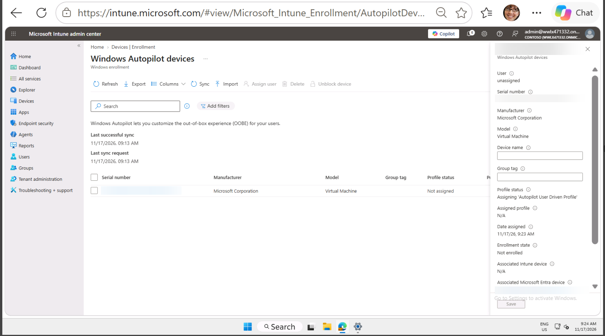

*Figure 2 — The device registration appeared in Windows Autopilot. The profile moved from Not assigned to **Assigning**; the screenshot does not demonstrate completed assignment or out-of-box provisioning.*

The exercise stopped before reset and the out-of-box experience. It established registration and preparation, not a completed Autopilot deployment.

The foundation mattered because later application and security policies reused these same groups, device records, and delegation boundaries instead of starting with unrelated objects each time.

---

## Lab 02 — Configuration, compliance, and policy troubleshooting

### Windows configuration and assignment filters

The next requirement was to manage workstation settings centrally while separating pilot users from the broader Windows device group. I created Settings Catalog and device-restriction profiles and used assignment filters for more precise targeting.

| Configuration | Details |
|---|---|
| `Config - Power Settings` | No unattended sleep on AC (`0` seconds); sleep after **1,800 seconds** on battery |
| `Config - Device Restrictions` | Device restrictions, password behavior, manual unenrollment, and Defender-related settings; assigned to pilot users |
| `Filter - Microsoft corporate, no kiosks` | Checks Microsoft manufacturer and excludes Kiosk device category |
| `Filter - SEA-DEV1 Exclude` | Excludes `SEA-DEV1` by device name where assigned |

```text
(device.manufacturer -eq "Microsoft") -and (device.deviceCategory -ne "Kiosk")
(device.deviceName -eq "SEA-DEV1")
```

The first filter name suggests corporate ownership, but the expression **does not test ownership**. It tests manufacturer and category only. This is an important distinction when reviewing whether a filter implements the intended access boundary. The Pharmacy scope tag was retained on selected configurations to support the later helpdesk exercise.

### Compliance and Conditional Access

I configured **Compliance - Windows Security Baseline** for Windows devices. It evaluated BitLocker, Secure Boot, code integrity, storage encryption, firewall, antivirus and current Defender protection, password requirements, and a minimum OS version of **`10.0.19045`**. Noncompliance handling included a **seven-day grace period** and an email notification after **one day**.

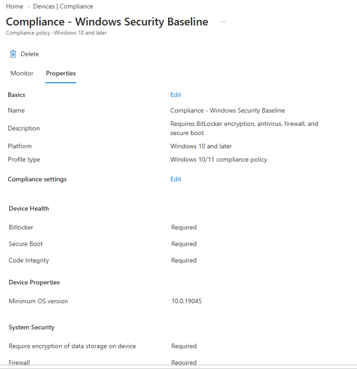

*Figure 3 — Saved compliance requirements for encryption, Secure Boot, code integrity, and other Windows security controls. This shows the policy configuration, not proof that a particular device passed all checks.*

I then configured **CA - Require compliant device (Pharmacy pilot)** in Entra ID. The intended grant condition was a compliant device, with the lab administrator excluded from the pilot rule. The policy remained **Report-only**, and a report-only sign-in record was reviewed. Devices later showed **In grace period**. The separate outside-pilot comparison was skipped, so this project does **not** claim enforced access blocking or a fully tested administrator exclusion.

### Moving supported Group Policy settings to Intune

I imported **`GPO_Desktop_Settings.xml`** into **Group Policy analytics** to assess which on-premises policies were suitable for modern device management. The readiness result showed **25% MDM support: 2 of 8 settings**.

The two supported policies were:

- **Prevent changes to Taskbar and Start Menu Settings**
- **Remove Run menu from Start Menu**

I migrated those supported settings into **Migrated - GPO Desktop Settings**, and the profile later reported **Succeeded** on `SEA-DEV1`. The remaining six settings were not represented as successful migrations. The exercise made the limitation of a one-to-one GPO migration concrete: evaluate support first, then move only what Intune can manage.

### Windows updates and a deliberate conflict

The lab used a staged update design, with **Update Ring - Pilot** applying **0-day** quality and feature deferrals and **Update Ring - Standard** applying **7-day quality** and **14-day feature** deferrals. I also configured a Windows 11 **25H2** feature-update profile, expedited critical updates with a two-day reboot deadline, and enabled endpoint analytics/data collection. The data collection policy reported **Succeeded**; long-term performance analytics and temporary-file remediation were not verified.

The update-ring assignments overlapped, and `SEA-DEV1` later displayed both rings in **Conflict**. That remained unresolved at this checkpoint.

To investigate policy behavior more directly, I deliberately created two pilot camera profiles with opposite **Allow Camera** settings. Both showed **Conflict** on the device. I reviewed the device configuration and per-setting status, removed **WIN - Camera - Enabled (Pilot)**, synchronized the device, and refreshed the report after processing.

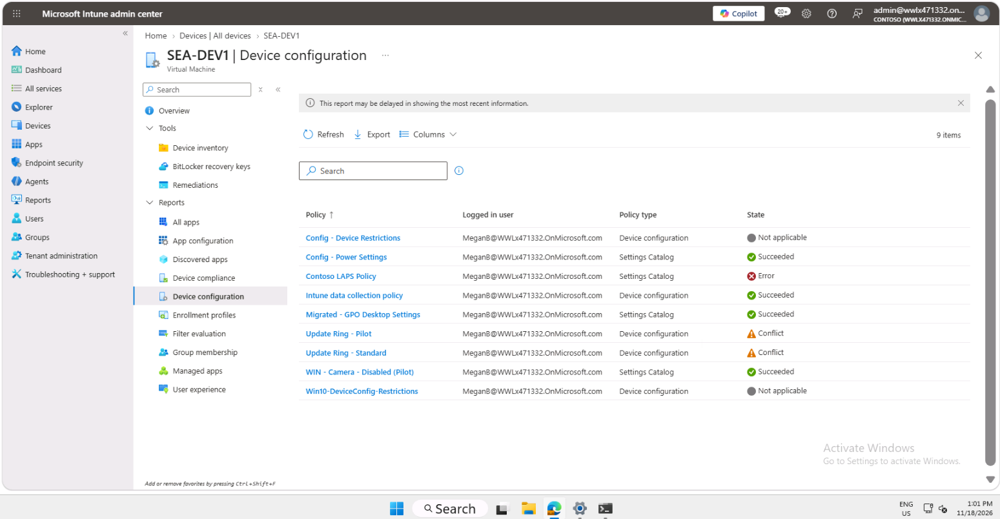

*Figure 4 — **WIN - Camera - Disabled (Pilot)** changed to **Succeeded** after the contradictory Enabled profile was removed. The same report still showed update-ring conflicts and a LAPS error.*

That sequence gave me a specific troubleshooting result: identify conflicting configuration, correct the assignment, then confirm the device-reported outcome. It did not mean every other policy on the endpoint was healthy.

---

## Lab 03 — Application delivery and mobile data protection

### Packaging and deploying 7-Zip

Contoso's IT team needed a way to distribute approved software and verify the result on managed devices. I downloaded the official **7-Zip 26.06 x64 MSI**, separated source and output folders, and created an Intune Win32 package with the **Microsoft Win32 Content Prep Tool**.

My first attempt failed because PowerShell's current directory did not contain `IntuneWinAppUtil.exe`. After correcting the executable path, I created the `.intunewin` package:

```powershell
& 'C:\Program Files\IntuneWinAppUtil\IntuneWinAppUtil.exe' `
    -c 'C:\LabAssets\Win32-App\Source' `
    -s '7z2606-x64.msi' `
    -o 'C:\LabAssets\Win32-App\Output'
```

The Win32 application used **System** installation, an **x64** requirement, Windows 10 **1607** minimum, MSI product-code detection, a **Required** assignment to `sg-Intune-Pilot-Users`, and the Pharmacy scope tag.

### Troubleshooting a failed MSI installation

Both endpoints initially reported **Failed** with Windows Installer error **`0x80070653`**, indicating that the installation package could not be opened. I checked the application **Program** properties and found that the install command still contained the literal placeholder `<filename>.msi`; the uninstall command contained a placeholder product-code GUID.

Rather than rebuild the package unnecessarily, I corrected the two Intune command fields to match the packaged MSI and its detection rule:

```powershell
# Install command
msiexec /i "7z2606-x64.msi" /qn

# Uninstall command
msiexec /x "{23170F69-40C1-2702-2606-000001000000}" /qn
```

The commands are the separate **installation** and **uninstallation** fields in Intune; they are not intended to be run consecutively on a workstation. After saving the configuration and allowing device synchronization and reporting, both devices reported Installed.

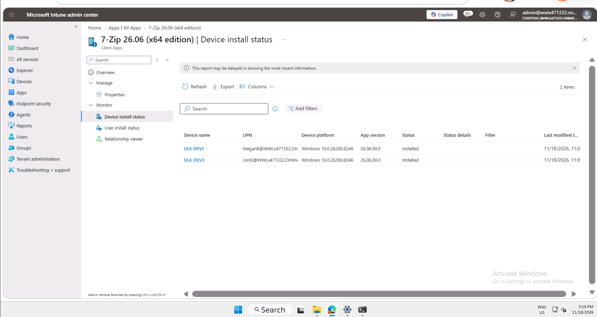

*Figure 5 — The original 7-Zip 26.06 package reported **Installed** on both `SEA-DEV1` and `SEA-DEV2` after the MSI command correction.*

This was one of the clearest end-to-end troubleshooting outcomes in the project: a real reported failure, an identifiable configuration error, a targeted correction, and successful deployment status afterward.

### Store, catalog, and self-service applications

I compared several Intune delivery methods rather than assuming all apps required custom Win32 packaging:

| Delivery method | Lab configuration and evidence |
|---|---|
| Microsoft Store (new) | Microsoft To Do assigned Required to Windows devices; final installation not separately verified |
| Microsoft 365 Apps | x64 Office suite, Current Channel, Office Open XML, English; assigned Required to the Windows group, with final installation unverified |
| Enterprise App Catalog | Google Chrome x64 package with prebuilt commands and detection; offered as **Available** to pilot users in Company Portal |
| Custom Win32 | 7-Zip, with explicit installer, uninstall command, requirements, and MSI detection; installed on both devices |

Google Chrome appeared in Company Portal and was observed **Installing**, but a completed installation was not captured. Making an application Available offers approved self-service installation. It does not, by itself, prevent users from obtaining other software through alternative means.

I also created **7-Zip v2.0** as a superseding application using the **same MSI** as the original, with **Uninstall previous version** enabled. The original app showed removal in preparation for the replacement, but the new entry still showed **Not installed** after observation. This was a limited supersedence simulation, not a confirmed newer binary or a successful replacement rollout.

### Mobile Application Management (MAM)

I created two Intune App Protection Policies (APPs): **APP - iOS Data Protection** for seven applications and **APP - Android Data Protection** for six. The settings restricted organizational data transfer and copy/paste, prevented saving work content to unapproved locations, required encryption and a **six-digit app PIN**, required work-account credentials, and configured rechecks after **30 minutes of inactivity**.

The iOS policy allowed approved locations such as OneDrive for Business and SharePoint, while blocking printing and unmanaged native-application synchronization in the configured design. This is application-level data protection for supported apps, which can be useful for BYOD without requiring full enrollment. It is distinct from device-wide Intune management and from Conditional Access enforcement.

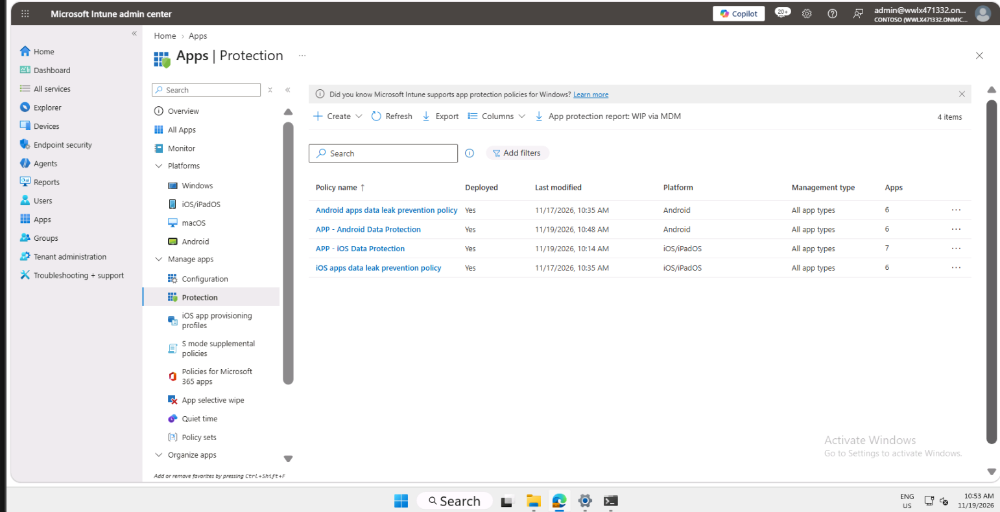

*Figure 6 — The Android and iOS application protection policies both showed **Deployed: Yes**. Enforcement on a real mobile client was not tested.*

---

## Lab 04 — Defender integration and endpoint protection

### Connecting Intune and Defender

The fourth lab extended the managed-device environment into threat visibility and protective policy configuration. I enabled the Intune connection in Microsoft Defender, completed the connector configuration in Intune, and created **EDR - Defender Onboarding** for `dyn-Windows-Devices` using the connector's automatic client configuration.

`SEA-DEV2` became visible in Defender before `SEA-DEV1`. After additional processing, both were listed in the device inventory. The `SEA-DEV1` overview showed **Health state: Active** and no active alerts or cases at the capture point.

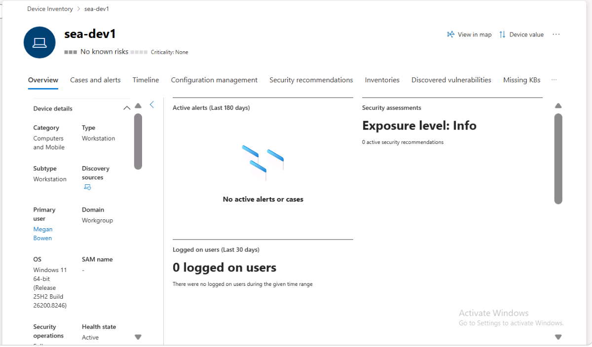

*Figure 7 — `SEA-DEV1` appeared in Defender's device inventory with an Active health state and no active cases or alerts at the time of capture. This verifies endpoint visibility, not the outcome of every security setting.*

### Security baselines, antivirus, firewall, and ASR

I configured the following Intune security objects, carrying the Pharmacy scope tag into the delegated-management design:

| Policy | Configuration or intent |
|---|---|
| Security Baseline - Defender for Endpoint | Microsoft-recommended baseline; an alternate disk-encryption warning was disabled to align with planned BitLocker settings |
| Antivirus - Defender Configuration | Real-time, cloud, and behavior monitoring; high cloud block level; daily quick scan and on-access protection |
| Firewall - Defender Configuration | Domain, Private, and Public profiles enabled; allowed and dropped connection logging; public inbound default Block |
| ASR - Block (Pilot) | Eleven Attack Surface Reduction rules intended to block common malicious activity for pilot users |
| ASR - Audit (Fleet) | Broad monitoring of the same types of behavior; LSASS credential-stealing protection retained in Block mode |

The ASR work covered Office child-process creation and code injection, email/webmail executables, obfuscated or downloaded scripts, LSASS credential theft, WMI persistence, PsExec/WMI process creation, unsigned USB content, and Office macro Win32 API calls. The distinction between **Audit** and **Block** matters: one records activity for review, while the other is designed to prevent it.

The fleet ASR assignment excluded **`SEA-DEV1`** by device filter. It did **not** establish that every pilot device was excluded from the fleet assignment, and I did not confirm conflict-free enforcement of every rule.

### BitLocker: configuration versus actual encryption

I configured **BitLocker - Full Disk Encryption**, assigned to the Windows device group, using the Pharmacy scope tag and silent-encryption-related settings. The intended outcome was encryption at rest with recovery information centrally available.

Rather than assume assignment proved encryption, I opened an elevated terminal on `SEA-DEV1` and ran:

```powershell
manage-bde -status C:
```

The result was **Fully Decrypted**, **0.0% encrypted**, **Protection Off**, and **no key protectors**. A later recovery-key check also returned no BitLocker key.

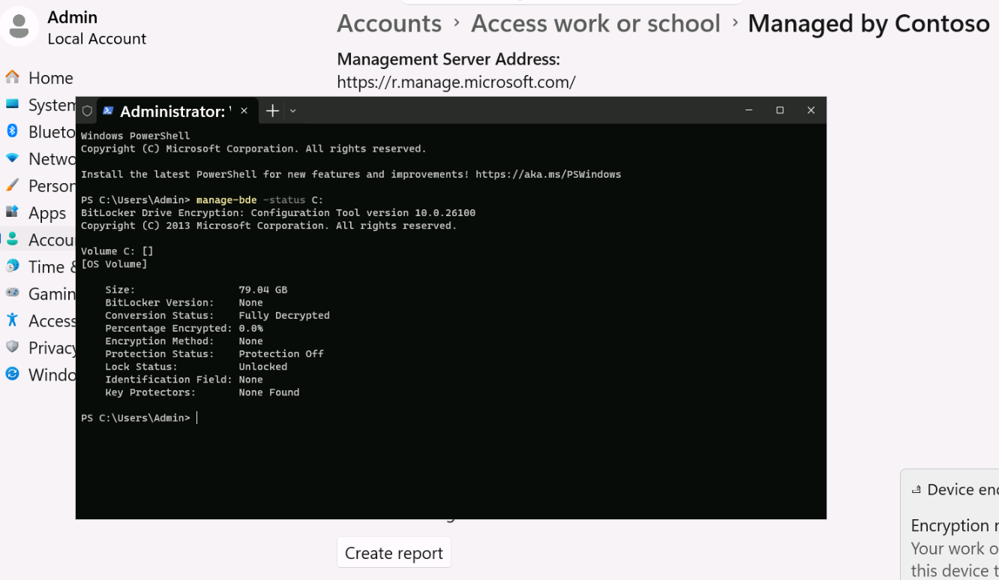

*Figure 8 — The operating-system volume was fully decrypted when checked. Encryption and Entra recovery-key escrow were not verified.*

Although the lab noted that policy processing might take one to three hours, that estimate is not evidence of later success. A discrepancy between an AD DS-related recovery setting and the intended Entra escrow destination was a possible investigation lead, not an established root cause.

### Linux-based Microsoft Tunnel gateway

For remote mobile connectivity, I prepared **`LIN-SRV1`**, an Ubuntu server, as a Microsoft Tunnel gateway. The design used Intune for centralized configuration and a Linux gateway to terminate a VPN connection to private resources. This Linux host was not automatically an Azure VM simply because its management service was cloud-based.

The sequence included connecting to the server with SSH, installing Docker prerequisites, creating a Tunnel server configuration and site, staging a **lab-only self-signed TLS certificate**, and running the Tunnel setup process. The server configuration used **port 443** and the site used the server's recorded IP address. The certificate included the hostname and IP in its SAN, with restricted private-key permissions.

Early in the process, `chmod` failed because I had run the Linux command in the Windows PowerShell context. Switching to the actual Ubuntu SSH session let me apply the Linux file permissions and continue the setup.

```bash
hostname -I
# From Windows: ssh labuser@<LIN-SRV1-IP>
sudo mst-cli server status
sudo mst-cli agent status
```

After registering the gateway through the lab administrator's device-code flow, it appeared under **Contoso HQ Tunnel** but reported **Unhealthy**. This confirms registration, **not** a functioning VPN. The final VPN-profile rollout and mobile-client connectivity test were not completed; the hosted lab did not supply a mobile test client.

### Cloud PKI and security posture

I began configuring Microsoft Cloud PKI for device certificate authentication. The intended hierarchy separated a trusted root CA from an issuing CA, with trusted-certificate profiles and SCEP enrollment for client certificates.

| Component | Configuration and observed state |
|---|---|
| Contoso Root CA | Created and showed Active; 25-year validity, RSA-4096/SHA-512, and client/server authentication EKUs in the lab design |
| Contoso Issuing CA | Blocked: the root selector returned **No matching CAs found**, despite the root CA being Active |
| Trusted-certificate profiles | Intended for Root and Intermediate certificate stores; not completed after the issuing-CA blocker |
| SCEP - Device Authentication | Planned one-year client certificate, device identity and DNS SAN, TPM-preferred storage, and 20% renewal threshold; not deployed |

I did not delete or recreate the Active root to force a workaround because the cause of the selector issue had not been established. The blocked certificate steps were skipped so the remaining security lab could continue.

Microsoft Secure Score was also reviewed. It showed **54.18% overall**, with **Identity 15.99%**, **Data 77.78%**, **Device 61.33%**, and **Apps 45.78%** at that moment. Those values describe the training tenant's point-in-time posture; they do not measure an improvement caused by this project. The filtered alerts view returned no incidents to investigate. The final Conditional Access What If test was skipped, and the pilot CA policy remained Report-only.

**Lab 04's strongest confirmed outcome was Defender endpoint visibility.** BitLocker, the Tunnel gateway, and the Cloud PKI hierarchy each required further validation before they could be treated as working protections.

---

## Lab 05 — Microsoft Graph, remediation, and delegated operations

### Application-based Microsoft Graph authentication

I moved beyond portal-only administration by installing **PowerShell 7.7.0** and Microsoft Graph modules, then registering a single-tenant **Intune Automation App** in Entra ID. The app used **application permissions** for an app-only session, rather than a user-delegated sign-in.

The successful connection context showed these four permissions:

| Microsoft Graph permission | Reason for access |
|---|---|
| `DeviceManagementManagedDevices.Read.All` | Managed-device inventory and compliance state |
| `DeviceManagementConfiguration.ReadWrite.All` | Read and manage device configuration policies |
| `DeviceManagementRBAC.Read.All` | Intune RBAC and scope-tag information |
| `Group.Read.All` | Resolve group identities for inventory and targeting workflows |

The lab also listed `DeviceManagementApps.ReadWrite.All`, but I did not verify it in the captured successful connection. The configured application credential identifies the caller; Microsoft Graph permissions still determine what that caller can do.

### Troubleshooting credentials and PowerShell sessions

The first authentication attempts failed. A direct token-request diagnostic returned **`AADSTS7000216`**, meaning the client secret was missing from the request. I distinguished the application's **Secret ID** from the actual **Secret Value**, checked that the secure credential input was populated, and created a replacement credential.

Another attempt from **PowerShell ISE** failed because the Graph session was **process-scoped**: authenticating in PowerShell 7 did not automatically carry the token into another PowerShell process. I returned to the intended PowerShell 7 terminal and verified:

```text
AuthType: AppOnly
TokenCredentialType: ClientSecret
ContextScope: Process
```

The published [Connect-GraphApp.ps1](scripts/Connect-GraphApp.ps1) replaces the lab's hardcoded secret with a secure prompt. It is a safer publication copy, **not** a claim that the revised file itself was rerun against the tenant.

### Reading managed devices and tagged policies

I queried Intune-managed devices and filtered the list to Windows endpoints using Microsoft Graph:

```powershell
Get-MgDeviceManagementManagedDevice |
    Select-Object DeviceName, OperatingSystem, ComplianceState, LastSyncDateTime

Get-MgDeviceManagementManagedDevice -Filter "operatingSystem eq 'Windows'" |
    Select-Object DeviceName, OperatingSystem
```

The filtered query returned **`SEA-DEV1`** and **`SEA-DEV2`**. I also located the **Pharmacy** scope tag, which returned ID **`1`**, and observed at least one matching configuration-policy result. Longer query blocks were entered in smaller sections because the hosted console had limitations when pasting large commands. A complete compliance-policy inventory result was not established.

The [Get-PharmacyPolicies.ps1](scripts/Get-PharmacyPolicies.ps1) publication copy selects objects whose `RoleScopeTagIds` include the Pharmacy tag. This is a **query filter**, not a security boundary for the app-only Graph identity. The later Graph-based compliance-policy creation and assignment tasks were skipped.

### Pilot remediation: stale Windows Update cache

I created **Remediation - Clear Stale Windows Update Cache** using two PowerShell scripts. The [detection script](scripts/Detect-StaleWindowsUpdateCache.ps1) searches for files older than **30 days** in `C:\Windows\SoftwareDistribution\Download`. Exit code **`1`** indicates an issue for Intune to remediate; **`0`** indicates none was detected by that script. The [remediation script](scripts/Remediate-StaleWindowsUpdateCache.ps1) attempts to stop Windows Update, remove aged files, and restart the service.

| Setting | Lab configuration |
|---|---|
| Scripts | Detection and remediation files uploaded separately |
| Execution identity | SYSTEM, using 64-bit PowerShell |
| Signature check | Disabled for the lab |
| Assignment | `sg-Intune-Pilot-Users` only |
| Schedule | Daily, **4:00 PM** in the saved policy properties |

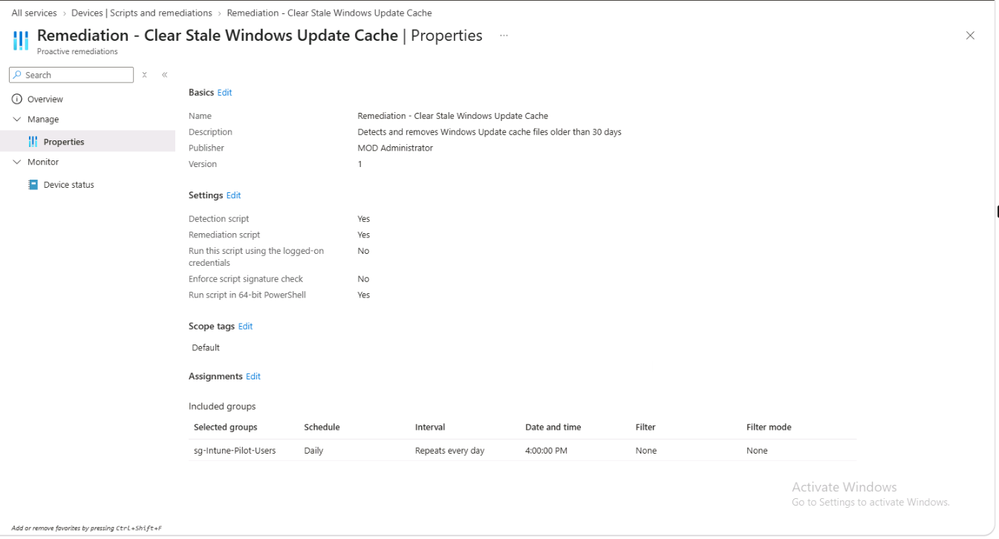

*Figure 9 — The remediation package contains both scripts and a daily pilot assignment. This confirms its configuration, not device execution or successful cache cleanup.*

The **Device status** report remained empty even after the recorded **12-hour** wait. That neither proves the scripts never ran nor verifies that they succeeded. I did not expand the assignment to the fleet.

The source scripts also use `-ErrorAction SilentlyContinue` for some operations, so they may suppress filesystem or service errors. A production-ready remediation would use explicit error handling, restore the service even after failure, recheck the affected files, and report meaningful results. The repository retains the actual training logic and calls out that limitation.

### Pharmacy Helpdesk RBAC validation

I completed the delegated-administration design created in Lab 01 by assigning the **Pharmacy Helpdesk** role to **`sg-Pharmacy-Helpdesk-Admins`**, which included **Lee Gu**. I used **`dyn-Windows-Devices`** as the scope group and the **Pharmacy** tag for the objects that the delegated role should see.

The role provided selected read and device-support operations while excluding policy creation, editing, deletion, assignment changes, and device wipe/delete. In an **InPrivate** session as the delegated user, the **Antivirus - Defender Configuration** policy was visible, but its Properties page did not offer Edit controls and Delete was disabled.

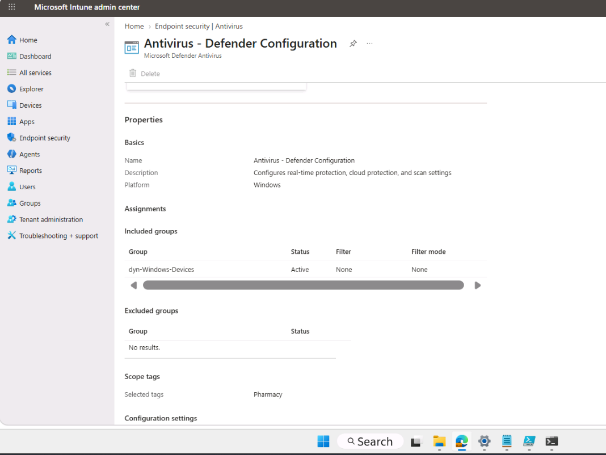

*Figure 10 — The Pharmacy-tagged antivirus policy was visible without editing controls during delegated administration. The cropped image does not independently show the signed-in account.*

This test was useful because it checked the actual experience of a restricted administrator rather than only reviewing the configured role definition. Lab 06 continued the delegation test with a scoped device list.

I also reviewed the role of Intune and Entra audit logs, reporting, and service-health views. Individual audit events and completed exports were not retained as verified evidence. An Azure Monitor/Log Analytics diagnostic pipeline was conceptual scope only; no such pipeline was deployed.

---

## Lab 06 — Endpoint Privilege Management and Remote Help

### Controlled application elevation

The final lab introduced **Endpoint Privilege Management (EPM)** to let standard users elevate approved applications without making them permanent local administrators. I configured **EPM Settings - Default Behavior** for `dyn-Windows-Devices`, enabled EPM and elevation reporting, and set the default user response to require confirmation and a business justification.

The policy reported **2 Succeeded**, **0 Error**, **0 Conflict**, and **0 In progress** device check-ins.

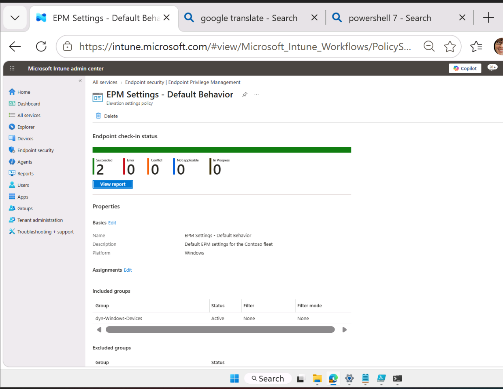

*Figure 11 — The EPM settings policy successfully checked in on two devices. That proves policy delivery, not successful execution of every rule.*

I worked through three file-hash elevation rule patterns:

| Executable | Intended elevation behavior |
|---|---|
| `regedit.exe` | Automatic elevation for an approved Registry Editor binary |
| `msconfig.exe` | User-confirmed elevation with a justification |
| `cmd.exe` | Support-approved request rather than immediate elevation |

The rules used the executable name, restricted path, and SHA-256 hash to identify the file rather than requiring a signing certificate. For example:

```powershell
Get-FileHash -Path 'C:\Windows\regedit.exe' -Algorithm SHA256
Get-FileHash -Path 'C:\Windows\System32\msconfig.exe' -Algorithm SHA256
Get-FileHash -Path 'C:\Windows\System32\cmd.exe' -Algorithm SHA256
```

An automatic-rule creation attempt initially failed; a later retry was reported successful, but the cause of the original error was not confirmed. The lab also joined `SEA-DEV3` to Entra ID for testing. An **EPM confirmation prompt appeared for `msconfig.exe`**, though application launch after confirmation was not established.

For `cmd.exe`, an administrator Command Prompt opened after confirmation **without** the expected justification or support-approval prompt. This might have reflected default behavior or incomplete rule application; the evidence does not determine which. Without an approval record and matching rule verification, I cannot describe the support-approved path as successful. EPM report validation was not captured.

### Deploying Remote Help as managed software

I enabled **Remote Help**, restricted the support service to enrolled devices, and worked through Intune Suite licensing for the helper, recipient, and delegated administrator. I used the Win32 Content Prep Tool to package the Remote Help installer, then configured a Required Windows device assignment.

| Field | Configuration |
|---|---|
| App | Remote Help, Microsoft Corporation |
| Install | `remotehelpinstaller.exe /quiet acceptTerms=1` |
| Uninstall | `remotehelpinstaller.exe /uninstall /quiet acceptTerms=1` |
| Detection | `RemoteHelp.exe` exists in `C:\Program Files\Remote help` |
| Target and context | Required to `dyn-Windows-Devices`; SYSTEM; x64 |

At first, Remote Help did not appear in Windows Search, and the Intune install report contained no devices. I confirmed the assignment and synchronized the endpoint rather than interpreting a blank report as a definitive failure or success.

Later, **Megan Bowen** assisted **Joni Sherman** on **`SEA-DEV2`**. The Remote Help reporting page recorded the provider, recipient, device, and session start and end fields.

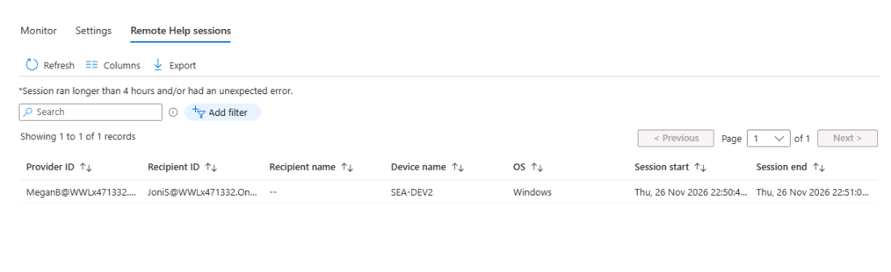

*Figure 12 — The session report identifies Megan as provider, Joni as recipient, and SEA-DEV2 as the assisted device. It does not establish which full-control actions occurred during the session.*

A session record is stronger evidence of the support workflow than a software assignment alone. The Remote Help process uses organizational sign-in, session codes, and the recipient's consent; live support codes and credentials should not be published.

### Delegation and extended topics

In a separate scoped Intune session as **Lee Gu**, only `SEA-DEV1` appeared in **All devices**, supporting the Pharmacy visibility boundary. The recorded Remote Help session above involved Megan and Joni, **not** Lee; I did not capture a separate successful Lee-initiated session.

Advanced Analytics and Device Query were also covered, including KQL-style inventory and posture questions, but no populated query result or query-generated group was verified. Windows 365 Cloud PC and Azure Virtual Desktop were conceptual demonstrations, **not** deployed desktops or session hosts in this project.

---

## Results and operational significance

| Lab | Verified evidence | What remains unverified or unresolved |
|---|---|---|
| **01 — Foundation** | Two Intune-managed Windows devices; Autopilot registration record | Device ownership discrepancy, LAPS error, final Autopilot assignment/OOBE |
| **02 — Device management** | 2 of 8 GPO settings migrated; migration and camera profile reported Succeeded | Update-ring conflicts; Conditional Access remained Report-only |
| **03 — Applications** | 7-Zip Installed on two endpoints after correcting `0x80070653`; two APPs reported Deployed | Supersedence replacement; mobile policy enforcement |
| **04 — Security** | Defender device health Active; Cloud PKI root CA Active | BitLocker encryption and key escrow; Tunnel health and VPN; issuing CA and client certificates |
| **05 — Operations** | Graph app-only authentication, Windows inventory, Pharmacy tag lookup; delegated read-only access | Complete Graph policy results; remediation execution and cleanup; broader rollout |
| **06 — Advanced** | Two EPM settings check-ins; observed elevation prompt; recorded Remote Help session | Rule-by-rule elevation success and approval; populated analytics results |

### Why these exercises belong together

The six labs represent one endpoint-management lifecycle rather than six unrelated screenshots. The same Windows devices, pilot users, and Pharmacy delegation design carried through enrollment, configuration, applications, security, automation, and support. That continuity made it possible to see the differences between **a policy being created, a policy being assigned, a device reporting success, and an actual user or administrator workflow being verified**.

For administrators, the practical value is centralized onboarding and targeting, more consistent application delivery, greater visibility into device and security state, and narrower administrative privileges. The exercises also show the operational cost of inaccurate assumptions: a Win32 package can be uploaded but fail due to the install command, overlapping policies can conflict, and a security policy can exist while encryption remains off.

The environment did not measure company-wide efficiency or risk reduction. These are benefits supported by the administration model, not quantified production outcomes.

## PowerShell and implementation files

Four PowerShell scripts are included under [`scripts/`](scripts/), with the behavior and evidence limits documented in their corresponding lab sections.

| Script | Purpose | Evidence boundary |
|---|---|---|
| [`Connect-GraphApp.ps1`](scripts/Connect-GraphApp.ps1) | App-only Graph connection using a secure client-secret prompt | Rewritten publication copy was not rerun against the tenant |
| [`Get-PharmacyPolicies.ps1`](scripts/Get-PharmacyPolicies.ps1) | Read tagged Intune configuration and compliance policies | Tag lookup and some results were observed; full output not verified |
| [`Detect-StaleWindowsUpdateCache.ps1`](scripts/Detect-StaleWindowsUpdateCache.ps1) | Find cache files older than 30 days and signal remediation | Script uploaded; execution report unavailable |
| [`Remediate-StaleWindowsUpdateCache.ps1`](scripts/Remediate-StaleWindowsUpdateCache.ps1) | Attempt aged-file cleanup and Windows Update service restart | Script uploaded; successful cleanup not verified |

Run the Graph inventory queries in the same PowerShell 7 process after authentication, with the necessary `Microsoft.Graph` and `Microsoft.Graph.Beta` modules. The secret **Value** must be supplied privately; neither tenant secrets nor access tokens belong in a public repository. The cache remediation uses training logic with suppressed errors and must be reviewed and independently validated before broader use.

## Repository layout

```text
Microsoft-365-Endpoint-Management/
├── README.md
├── assets/
│   └── m365-endpoint-management-fox-banner.webp
├── screenshots/
│   ├── 01-enrolled-devices.png
│   ├── 02-autopilot-registration.png
│   ├── 03-windows-compliance.png
│   ├── 04-camera-conflict-resolved.png
│   ├── 05-win32-installed.png
│   ├── 06-mobile-app-protection.png
│   ├── 07-defender-endpoint-health.png
│   ├── 08-bitlocker-status.png
│   ├── 09-remediation-pilot.png
│   ├── 10-pharmacy-rbac.png
│   ├── 11-epm-policy.png
│   └── 12-remote-help-session.png
└── scripts/
    ├── Connect-GraphApp.ps1
    ├── Get-PharmacyPolicies.ps1
    ├── Detect-StaleWindowsUpdateCache.ps1
    └── Remediate-StaleWindowsUpdateCache.ps1
```

**Evidence and privacy:** Screenshots are selected lab checkpoints, not staged production results. Passwords, app secrets, access tokens, device login codes, recovery keys, private keys, and unnecessary tenant or device identifiers must not be published. Lab configuration, observed output, and unfinished validation are deliberately described separately.

**Source:** Six MSSA MD-102 hands-on labs, accompanying training notes and original captured results. The published case study documents what was configured and what the evidence actually established; it does not imply an end-to-end production deployment.
